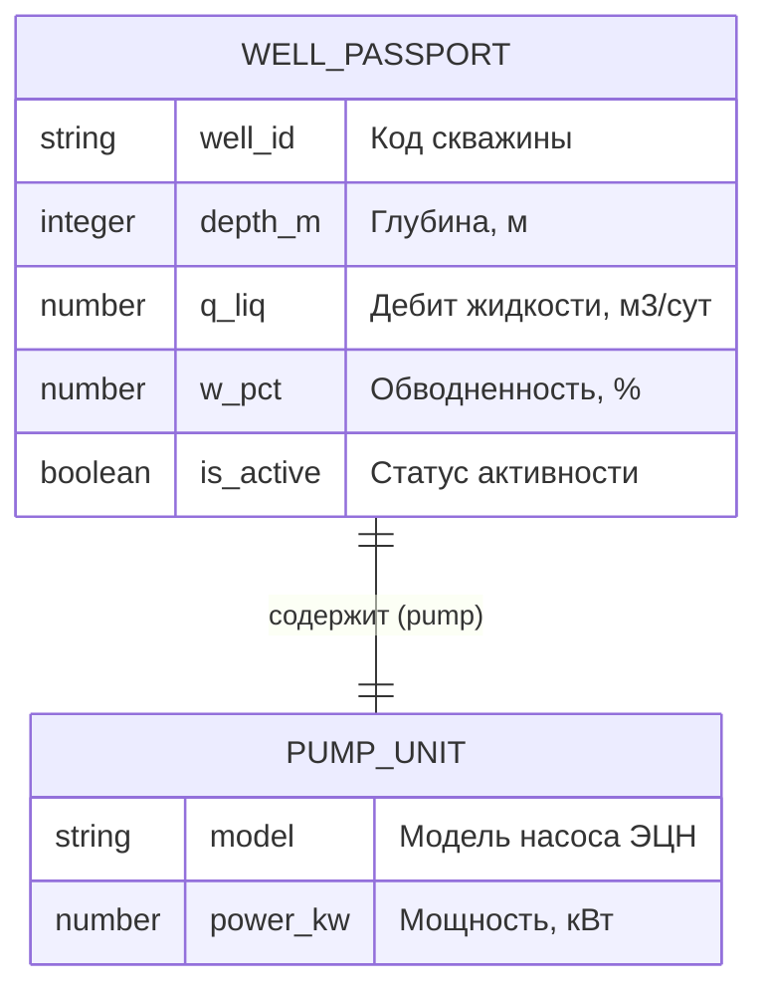

Тема : "Проектирование структур данных предметной области: схема сущностей,
полей и формат обмена данными (JSON и  JSON-Schema)"
ФИО: Сайфуллин Эмир Гильманов Тимур
Вариант - А
field_name="Приобское"

В файле data.json булевое значени True записано маленькими буквами как true, а также после значения 90 отсутсвтует запятая

1.1. Словарь вместо 8 переменных удобнее, потому что: не запутаешься в порядке значений (у каждого есть имя, например well["depth"]), легко добавлять новые поля без правки функции, и его просто сохранить в JSON или передать дальше.

1.2. Отличия JSON от dict: в JSON используют только двойные кавычки, вместо None/True/False пишут null/true/false, а комментарии и запятые в конце списка запрещены. Параметр ensure_ascii=False нужен, чтобы русские буквы не превращались в коды вроде \u0421 — так файл остаётся читаемым.

2.1. Контракт данных (JSON Schema) — это правила, по которым должны выглядеть данные: какие поля нужны, какого типа и в каких пределах.

required — поля, которые обязательно должны быть.
properties — описание каждого поля (тип, формат и т. д.).
minimum/maximum — допустимые границы чисел (например, глубина не может быть отрицательной).
enum — список разрешённых значений (например, только «активна», «в ремонте», «законсервирована»).

2.2. В Python True и False технически считаются числами: isinstance(True, int) возвращает True. Если проверять только на int, валидатор примет True как число 1 — и глубина скважины станет равна 1. Проверка not isinstance(depth, bool) отсекает логические значения, чтобы проходили только настоящие числа.
